# Ecos da Terra

**Dados da Terra para ouvir e sentir.** O Ecos da Terra transforma visualizações oficiais da NASA em som, voz e vibração. Com ele, pessoas cegas ou com baixa visão exploram os mesmos dados científicos que aparecem na tela.

Equipe **Núcleo404** · NASA Space Apps Challenge 2026

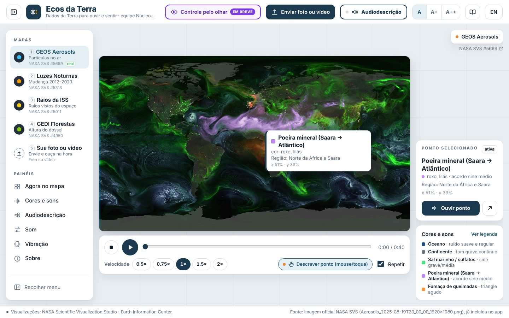

---

## Sumário

1. [O que é, em 1 minuto](#1-o-que-é-em-1-minuto)
2. [Como rodar](#2-como-rodar)
3. [Como usar](#3-como-usar)
4. [Funcionalidades](#4-funcionalidades)
5. [Arquitetura técnica](#5-arquitetura-técnica)
6. [Decisões técnicas e justificativas](#6-decisões-técnicas-e-justificativas)
7. [Acessibilidade](#7-acessibilidade)
8. [Privacidade e segurança](#8-privacidade-e-segurança)
9. [Desempenho](#9-desempenho)
10. [Compatibilidade](#10-compatibilidade)
11. [Limitações do MVP](#11-limitações-do-mvp)
12. [Roteiro: próximas funcionalidades](#12-roteiro-próximas-funcionalidades)
13. [Estrutura do repositório e como contribuir](#13-estrutura-do-repositório-e-como-contribuir)
14. [Créditos, fontes e licenças](#14-créditos-fontes-e-licenças)

---

## 1. O que é, em 1 minuto

Mapas de satélite são feitos para os olhos. Uma pessoa cega não tem como perceber que uma pluma de poeira sai do Saara e cruza o Atlântico, ou que as luzes noturnas da Índia cresceram entre 2012 e 2023.

O Ecos da Terra **lê a imagem como uma partitura**. Uma barra vertical percorre o mapa da esquerda para a direita. Em cada coluna, o programa conta as cores dos pixels e as traduz em som, seguindo regras próprias de cada mapa:

| O que está na imagem | Como vira som |
|---|---|
| **Qual fenômeno** (cor) | timbre: cada fenômeno tem um instrumento |
| **Onde** (altura na imagem) | nota: mais ao norte, mais agudo |
| **Quanto** (área e intensidade) | volume e ritmo |
| **De que lado** (posição horizontal) | som à esquerda ou à direita (estéreo) |

Três camadas de acessibilidade completam a experiência:

- **Audiodescrição:** uma voz descreve a imagem, explica as regras de som e diz o que há em cada ponto tocado, inclusive a região do planeta.
- **Legenda sonora:** antes da primeira varredura, o app apresenta cada cor e o som correspondente.
- **Vibração:** no celular, o dedo “sente” o mapa. O aparelho pulsa mais forte onde o dado é mais intenso.

A pessoa também pode enviar a **própria foto ou vídeo**. A análise acontece no aparelho: o app reconhece se a imagem é uma visualização da NASA, encaixa a geografia, identifica objetos e movimento e sonifica tudo em tempo real.

O método segue a abordagem da própria NASA em [“Data Sonification: Caldwell 73” (SVS #13786)](https://svs.gsfc.nasa.gov/13786/).

---

## 2. Como rodar

O Ecos da Terra é **um único arquivo**, o `index.html`. Ele não depende de servidor, instalação, compilação, conta ou chave de API.

### Opção A: abrir o arquivo (mais simples)

1. Baixe o repositório ou o `.zip`.
2. Dê dois cliques em `index.html`.

Os quatro mapas da NASA estão **embutidos** no arquivo, então o app funciona até sem internet.

### Opção B: servidor local (recomendado para desenvolvimento)

```bash
# na pasta do projeto
python3 -m http.server 8000
# abra http://localhost:8000
```

### Opção C: publicar no GitHub Pages

1. Envie os arquivos para um repositório público.
2. Em **Settings → Pages**, escolha a branch `main` e a pasta `/ (root)`.
3. O app fica em `https://<usuário>.github.io/<repositório>/`.

> **Dica para apresentações:** o Microsoft Edge tem vozes “Natural” gratuitas em português (Francisca, Thalita, Antonio), as mais humanas entre as vozes do sistema. Para testar a vibração, abra no **Chrome de um celular Android**.

### O que usa internet (opcional)

| Recurso | Quando baixa | Tamanho aproximado | De onde |
|---|---|---|---|
| Voz neural Piper (pt-BR ou en-US) | na primeira vez que a audiodescrição fala | ~90 MB (modelo + fonemizador + runtime) | Hugging Face (`rhasspy/piper-voices`) e jsDelivr |
| Reconhecimento de objetos (Human + CenterNet) | na primeira foto ou vídeo enviado | ~6 MB | jsDelivr (`@vladmandic/human`) |

Sem internet, o app continua funcionando: a voz do sistema substitui a voz neural, e a análise de cores, contornos e movimento segue normalmente. Só o reconhecimento de objetos fica desligado.

---

## 3. Como usar

1. **Escolha um mapa** no menu (teclas `1` a `4`) ou envie uma foto ou vídeo (`U`, ou arraste o arquivo para a tela).
2. **Ligue a audiodescrição** (`A`). A voz apresenta o mapa e as regras de som.
3. **Toque** (`Espaço`). Na primeira vez, a legenda sonora apresenta cada cor; depois, a barra percorre o mapa.
4. **Explore ponto a ponto:** passe o mouse ou o dedo sobre o mapa, ou use as setas com o mapa em foco. Com `E` ligado, cada ponto é falado.
5. **No celular:** deslize o dedo e sinta a vibração. Ajuste a intensidade no painel **Vibração**.

### Atalhos de teclado

| Tecla | Ação |
|---|---|
| `Espaço` | tocar ou pausar |
| `←` `→` | mover a barra (com `Shift`, salto maior) |
| `↑` `↓` | explorar na vertical, com o mapa em foco |
| `Enter` | descrever o ponto em foco |
| `L` | ouvir a legenda sonora |
| `A` | ligar ou desligar a audiodescrição |
| `D` | descrever a imagem |
| `R` | ler a tradução científica atual |
| `E` | descrever o ponto sob o mouse ou o dedo |
| `V` | ligar ou desligar a vibração |
| `1` a `5` | trocar de mapa (5 = sua foto ou vídeo) |
| `U` | enviar foto ou vídeo |
| `M` | abrir ou recolher o menu |
| `Esc` | fechar o painel aberto |

---

## 4. Funcionalidades

| Funcionalidade | Situação | Onde fica |
|---|---|---|
| Sonificação de 4 visualizações da NASA (aerossóis, luzes noturnas, raios da ISS, altura de florestas) | pronta | menu **Mapas** |
| Legenda sonora (cada cor com seu som, antes do mapa) | pronta | painel **Cores e sons** |
| Audiodescrição da imagem, das regras e do fenômeno atual | pronta | painel **Audiodescrição** |
| Descrição ponto a ponto, com região geográfica (mouse, dedo, teclado) | pronta | mapa + card **Ponto selecionado** |
| Tradução científica ao vivo (fenômeno, frequência, cor média, composição da coluna) | pronta | painel **Agora no mapa** |
| Envio de foto ou vídeo com análise local em tempo real | pronta | **Enviar foto ou vídeo** |
| Reconhecimento automático de visualizações da NASA enviadas, com geografia | pronta | card **Seu arquivo** |
| Reconhecimento de objetos (80 classes COCO) | pronta (precisa de internet na 1ª vez) | card **Seu arquivo** |
| Movimento em vídeos, transformado em cliques percussivos | pronta | faixa 5, com vídeo |
| Voz neural gratuita no navegador (Piper) | pronta (download de ~90 MB na 1ª vez) | painel **Audiodescrição** |
| **Vibração em níveis** ao deslizar o dedo | **nova** (Android) | painel **Vibração** |
| Silenciar ou isolar camadas sonoras | pronta | painel **Cores e sons** |
| Velocidade, escala musical e volumes independentes | pronta | player e painel **Som** |
| Português e inglês, texto em 3 tamanhos | pronta | barra superior |
| Documentação para o público leigo | **nova** | fim da página (**Como funciona**) |
| Controle pelo olhar, com IA | **em breve** (botão em destaque já na interface) | barra superior |

<p align="center">
  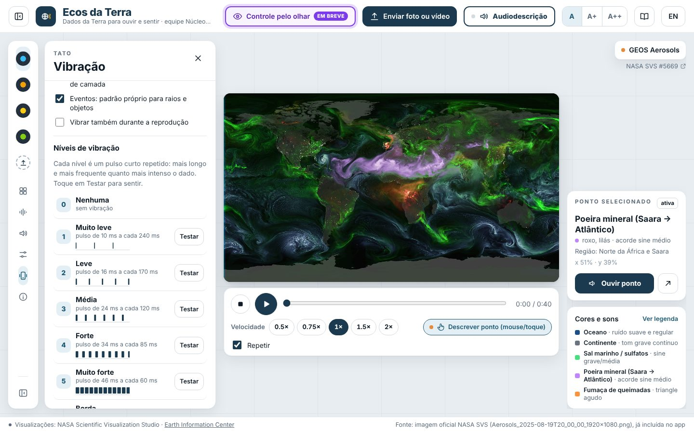
  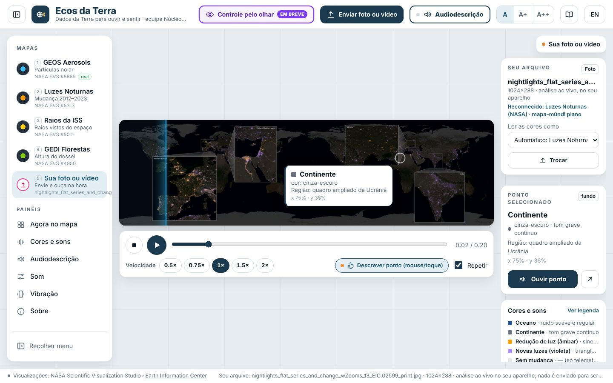
</p>
<p align="center">
  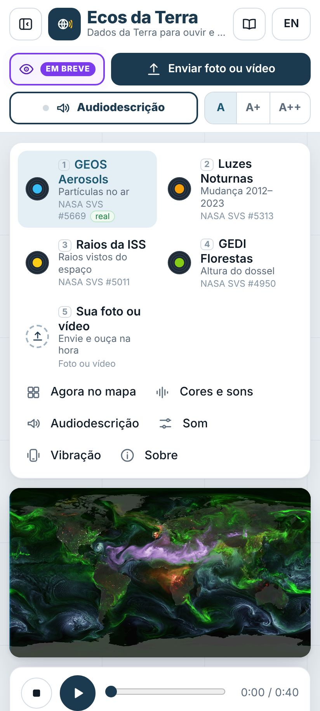
  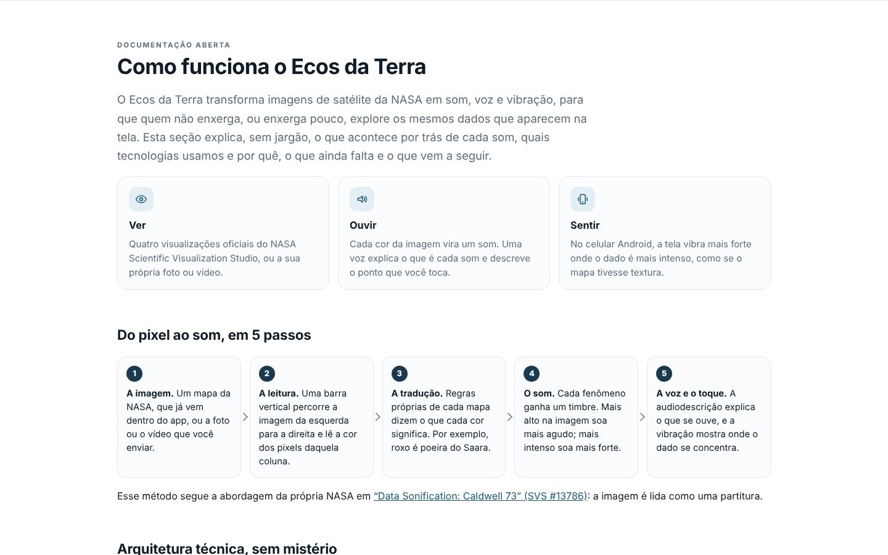
</p>

---

## 5. Arquitetura técnica

### 5.1 Visão geral

Tudo roda no navegador, em três camadas: **entrada → análise → saídas**.

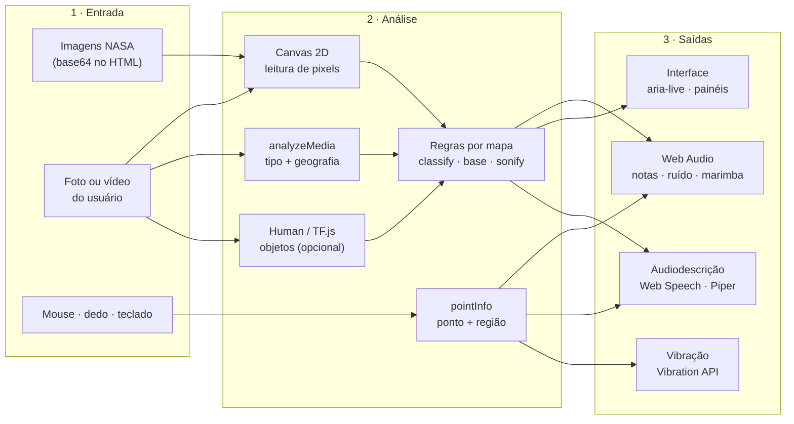

### 5.2 Por que um único arquivo

O `index.html` contém HTML, CSS, JavaScript e as quatro imagens da NASA, que somam cerca de 1,48 MB:

- ~1,15 MB são as imagens em base64;
- ~330 KB são código e textos.

Essa escolha (detalhada na [seção 6](#6-decisões-técnicas-e-justificativas)) atende a três objetivos:

- **Avaliação imediata:** júri, escolas e usuários abrem o app com dois cliques.
- **Funcionamento offline:** nada essencial depende de rede.
- **Imagens sempre legíveis:** os navegadores bloqueiam a leitura de pixels de imagens externas quando o arquivo é aberto pelo endereço `file://`. Embutidas em base64, as imagens sempre podem ser lidas.

O código é JavaScript puro (ES2020), dentro de uma única função autoexecutável (`(() => { 'use strict'; ... })()`), sem framework e sem etapa de build.

### 5.3 Mapa do código

O script principal está dividido em seções numeradas, na ordem em que aparecem no arquivo:

| Seção | Responsabilidade | Principais peças |
|---|---|---|
| 1. Utilitários | funções de apoio, carregamento sob demanda de bibliotecas, cache de arquivos grandes | `loadScript`, `idb`, `FileCache`, `fetchBuf` |
| 2. Geografia simplificada | contornos dos continentes em polígonos (lon, lat), máscara terra/mar de 1440×720 | `LAND`, `buildLandMask`, `isLand`, `orthoInverse` |
| 3. Réplicas procedurais | desenha versões aproximadas dos mapas se a imagem real falhar | `genAerosols`, `genNightlights`, `genISS`, `genGEDI` |
| 4. Escalas musicais | encaixa qualquer altura numa escala (pentatônica maior ou menor, lídio) | `SCALES`, `scaleFreq` |
| 5. Catálogo e regras | os 4 mapas e a faixa “Sua foto ou vídeo”: cor → fenômeno → som | `TRACKS`, `LEG`, `AMB_CFG`, `GENERAL`, `GEN_CATS`, `CUSTOM`, `applyRule` |
| 6. I18N | todos os textos em PT e EN; normalização de texto para a voz | `I18N`, `tr`, `speechify` |
| 7. Motor de áudio | síntese em tempo real com envelope ADSR, compressor e *ducking* | `AudioEngine` (`note`, `perc`, `noise`, `duck`) |
| 8. Audiodescrição | voz do sistema e voz neural Piper, fila de frases, escolha de voz | `Speech`, `Neural`, `NEURAL`, `splitSay`, `fillVoices` |
| 9. Estado e laço principal | estado global, leitura da coluna, sonificação, telemetria, quadro a quadro | `state`, `analyzeColumn`, `sonifyAt`, `scanLightning`, `updateTelemetry`, `frame` |
| 10. Carregamento das imagens | imagem embutida → arquivo ao lado → réplica procedural | `tryLoadReal`, `setSource`, `selectTrack` |
| 10b. Sua foto ou vídeo | envio, leitura de quadros, movimento, tipo de imagem, geografia, objetos | `loadMedia`, `mediaReady`, `captureFrame`, `computeMotion`, `analyzeMedia`, `fitGeo`, `OBJ` |
| 11. Interface | cards, legenda sonora, controles, idioma, audiodescrição | `playLegend`, `updateLegend`, `applyLang`, `setAD` |
| 11b. Descrição do ponto | o que há sob o mouse ou o dedo, e em que região do planeta | `GEO`, `landRegion`, `oceanRegion`, `regionAt`, `pointInfo`, `pointSound` |
| 11c. Menu, gavetas e encaixe | layout responsivo do mapa, painéis e cards laterais | `applyUI`, `openPanel`, `layoutMap` |
| 11d. Vibração | níveis, padrões e intensidade da vibração | `HAP`, `VIB_LV`, `VIB_AMT`, `Haptics`, `renderVib` |
| 12. Boot | inicialização | — |

### 5.4 O laço principal: do quadro ao som

A cada quadro da tela (`requestAnimationFrame`, ~60 vezes por segundo), a barra avança. A cada **passo** do mapa (entre 0,15 s e 0,3 s, dividido pela raiz da velocidade), a coluna sob a barra é analisada e sonificada.

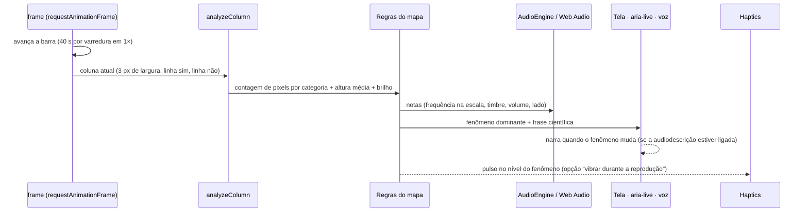

Detalhes do pipeline:

- **Leitura da coluna (`analyzeColumn`).** São lidos 3 pixels de largura, em linhas alternadas. Cada pixel passa por `classify` (fenômeno) e, se não for um fenômeno, por `base` (fundo: oceano ou continente). Para cada categoria, o programa guarda a contagem, a altura média e o brilho médio e máximo. Nas fotos, também procura **contornos**: picos de mudança brusca de brilho, no máximo 4 por coluna.
- **Altura → nota (`scaleFreq`).** A posição vertical média (topo = 1) vira um grau da escala escolhida, distribuído por 1 a 3 oitavas a partir de uma nota MIDI base própria de cada fenômeno. A escala pentatônica, padrão, evita dissonâncias quando várias camadas soam juntas.
- **Quantidade → volume.** O ganho cresce com a raiz quadrada da fração da coluna ocupada pelo fenômeno (`g = a + b·√fração`). Assim, plumas pequenas continuam audíveis e as grandes não estouram.
- **Envelope ADSR exponencial.** Cada nota tem ataque, decaimento, sustentação e repouso em rampas exponenciais, o que evita estalos. Um compressor (limiar de −18 dB, razão 4:1) segura os picos, e o motor limita a 40 vozes simultâneas.
- **Lado → estéreo.** Um `StereoPanner` posiciona cada som entre −0,8 (esquerda) e +0,8 (direita), conforme a posição na imagem.
- **Ducking.** Enquanto a voz fala, a música cai para 22% do volume e volta suavemente depois.

### 5.5 Regras de cada mapa

| Mapa (NASA SVS) | Cor | Fenômeno | Som |
|---|---|---|---|
| **GEOS Aerosols** (#5669) | verde e ciano | sal marinho e sulfatos | onda *sine* grave e longa |
| | roxo e lilás | poeira mineral do Saara | acorde *sine* médio de 3 notas |
| | vermelho-alaranjado | fumaça de queimadas | onda *triangle* aguda, em destaque |
| | azul-escuro / cinza | oceano / continente (fundo) | ruído filtrado como ondas / tom grave contínuo |
| **Luzes Noturnas 2012–2023** (#5313) | âmbar | luz que diminuiu | notas *sine* graves e suaves |
| | violeta | luzes novas | notas *triangle* agudas e brilhantes |
| | branco | luz sem mudança | sem som próprio (só telemetria) |
| | | ritmo | mais luz na coluna = ritmo mais denso (a cada 1, 2 ou 4 passos) |
| **Raios da ISS** (#5011) | amarelo-dourado | flash de raio (sensor LIS) | marimba percussiva no instante em que a barra cruza o flash |
| | branco | órbita da ISS e texto | ignorados |
| **GEDI Florestas** (#4950) | do marrom ao creme | altura do dossel, de 0 a 55 m | nota que sobe com a altura (3 oitavas) e uma segunda voz para o ponto mais alto |
| | azul / preto / faixa inferior | oceano / espaço / legenda | ignorados |
| **Sua foto ou vídeo** (regras gerais) | azul e ciano | provavelmente céu ou água | nota grave e longa |
| | verde | provavelmente vegetação | nota média e suave |
| | vermelho | — | notas agudas e curtas |
| | laranja, amarelo, marrom | provavelmente terra, areia ou madeira | pulsos de marimba |
| | roxo e rosa | — | acorde de 3 notas |
| | branco | luz, nuvens ou superfície clara | brilho bem agudo |
| | contornos | forma dos objetos | estalos curtos |
| | objetos reconhecidos | pessoas, veículos, animais… | sino de duas notas + nome falado |
| | movimento (vídeo) | o que mudou entre quadros | cliques percussivos onde algo se move |

Nas fotos e vídeos, a pessoa pode trocar as regras: **Automático**, **Cores gerais** ou as regras de qualquer um dos quatro mapas da NASA. Isso é útil, por exemplo, para sonificar outro quadro da mesma animação do SVS.

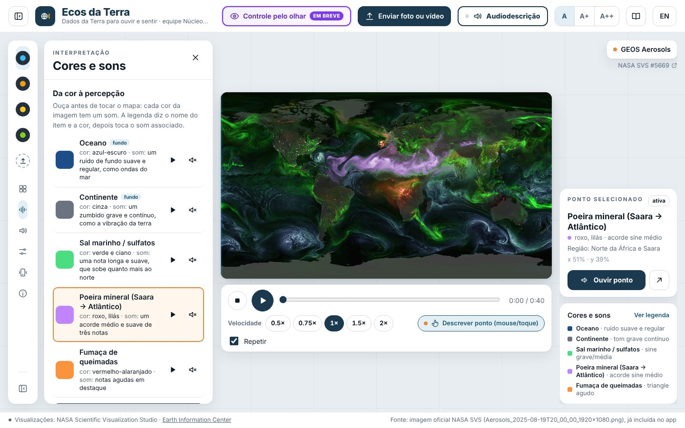

### 5.6 Descrição ponto a ponto

Quando o mouse, o dedo ou as setas param num ponto, `pointInfo` decide o que há ali:

1. **Objeto primeiro.** Se o ponto cai dentro da caixa de um objeto reconhecido, o app fala o nome do objeto.
2. **Votação na vizinhança.** Os pixels ao redor votam na categoria. O raio é maior para o dedo (largura/110) do que para o mouse (largura/320), porque o dedo cobre mais área. Fenômenos vencem o fundo; flashes de raio, que têm poucos pixels, são procurados num raio maior.
3. **Altura da floresta.** No GEDI, o percentil 90 do brilho da vizinhança é convertido em metros (0 a 55 m), seguindo a barra de cores original.
4. **Região do planeta.** Cada mapa tem a geometria calibrada à mão em `GEO`: projeção equirretangular para os mapas planos, ortográfica para os globos, e os quadros ampliados das Luzes Noturnas. O pixel vira longitude e latitude, e tabelas de regiões (`landRegion`, `oceanRegion`) dão o nome: “Norte da África e Saara”, “Oceano Atlântico Norte” etc. Como os contornos são simplificados, o tipo do fenômeno ajuda a desempatar: floresta nunca cai no mar.
5. **Saídas.** Com esse resultado, o app mostra um balão e o card **Ponto selecionado**, toca um som curto, fala uma frase pronta para a voz (`pointSpeech`) e, no celular, vibra.

### 5.7 Sua foto ou vídeo

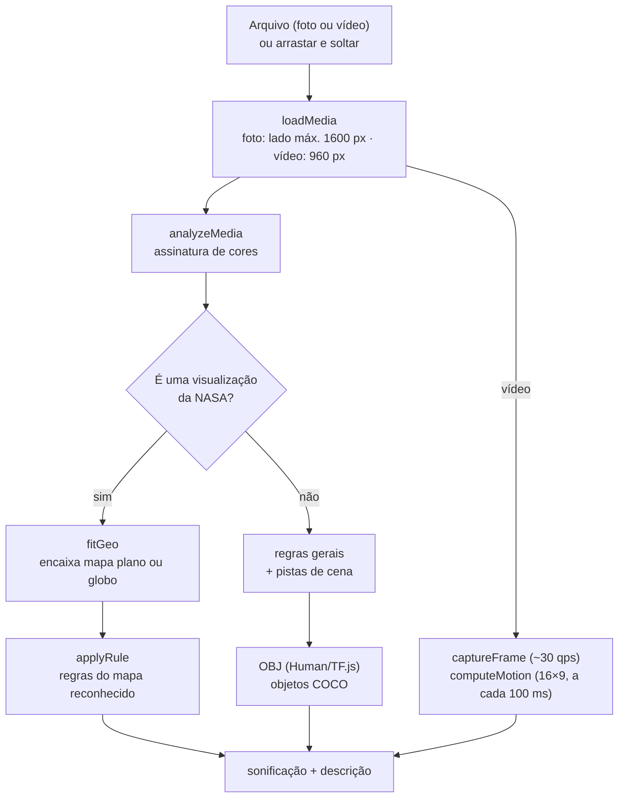

- **Tipo de imagem (`analyzeMedia`).** Amostra a imagem e mede uma “assinatura” de cores:
  - pixels pretos e escuros, luminância média e baixa saturação;
  - roxo de aerossol, verde neon, oceano e floresta;
  - cantos pretos (sinal de globo no espaço);
  - flashes, pontos âmbar e violeta.

  Combinações dessas medidas identificam aerossóis, luzes noturnas, raios, GEDI, uma imagem genérica da Terra ou uma imagem comum.
- **Geografia (`fitGeo`).** Primeiro, compara a proporção da imagem com a das visualizações oficiais do SVS (e, nos globos, confere a borda do disco). Se não bater, testa mapas planos candidatos. Para globos, encontra o disco da Terra (ajuste de círculo de Kåsa, com reajuste robusto) e busca, em grade, a rotação (longitude e latitude do centro) que melhor alinha terra e mar com a máscara de continentes. A pontuação é a acurácia balanceada terra/mar; o encaixe só é aceito com nota ≥ 0,78 e folga de 0,1 sobre a mediana das outras tentativas. Assim, uma foto comum não “vira” um globo por engano.
- **Vídeo.** Cada quadro novo é desenhado num canvas de análise enquanto o vídeo toca. O movimento é a diferença RGB entre quadros numa grade de 16×9 células, medida a cada 100 ms; uma célula conta como “em movimento” acima de 0,035. O vídeo acompanha Tocar/Pausar, velocidade e repetição do player.
- **Objetos (`OBJ`).** Usa a biblioteca **Human 3.3.6** (TensorFlow.js) com o modelo **CenterNet** treinado no COCO (80 classes): confiança mínima de 0,35 e até 15 objetos. Roda em WebGL, com alternativa em CPU; em vídeos, repete a cada 1,2 s. Os nomes são traduzidos para o português, com singular e plural.
- **Descrição automática (`autoVisual`).** Monta a frase da audiodescrição com:
  - formato e tamanho da imagem;
  - objetos e suas posições (à esquerda, no centro, no alto…);
  - cores dominantes por terço da imagem e brilho;
  - quantidade de contornos e, nos vídeos, movimento.

  As pistas de cena são sempre ditas como “provavelmente”.

### 5.8 Audiodescrição (voz)

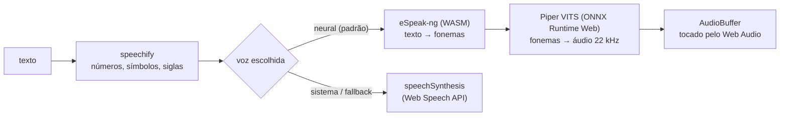

- **Normalização (`speechify`).** Prepara o texto para soar natural: tira extensões de arquivo, troca “→” por “para o”, “~” por “cerca de”, “2×” por “2 vezes”, “55 m” por “55 metros”, separadores por vírgulas etc.
- **Voz neural Piper.** É uma voz de código aberto que roda **inteira no navegador**:
  - o fonemizador eSpeak-ng, compilado em WebAssembly, converte o texto em fonemas;
  - o modelo VITS (`pt_BR-faber-medium` ou `en_US-lessac-medium`) roda no ONNX Runtime Web e transforma os fonemas em áudio;
  - o texto é dividido em frases curtas, e a próxima frase é sintetizada enquanto a anterior toca;
  - um cache guarda as últimas 160 frases, e os modelos ficam no Cache API do navegador (ou no IndexedDB), então o download acontece só uma vez.
- **Voz do sistema.** As vozes instaladas são ordenadas por qualidade: “Natural”, “Neural” e “Online”, as do Google e as pt-BR ganham pontos; eSpeak e similares perdem. Enquanto a voz neural baixa, ou se ela falhar, a melhor voz do sistema fala. A pessoa pode escolher qualquer voz no painel **Audiodescrição**.
- **Narração automática.** Durante a reprodução, a voz só fala quando o fenômeno dominante muda e se passaram pelo menos 4 s desde a última fala, para não atropelar a música. O leitor de tela recebe as mesmas informações por regiões `aria-live` quando a audiodescrição está desligada.

### 5.9 Vibração

A [Vibration API](https://www.w3.org/TR/vibration/) só sabe **ligar e desligar o motor** por durações em milissegundos; ela não controla a força. Por isso, o Ecos da Terra simula a intensidade por **modulação por largura de pulso**: quanto mais intenso o dado, mais longo o pulso e menor o intervalo entre pulsos.

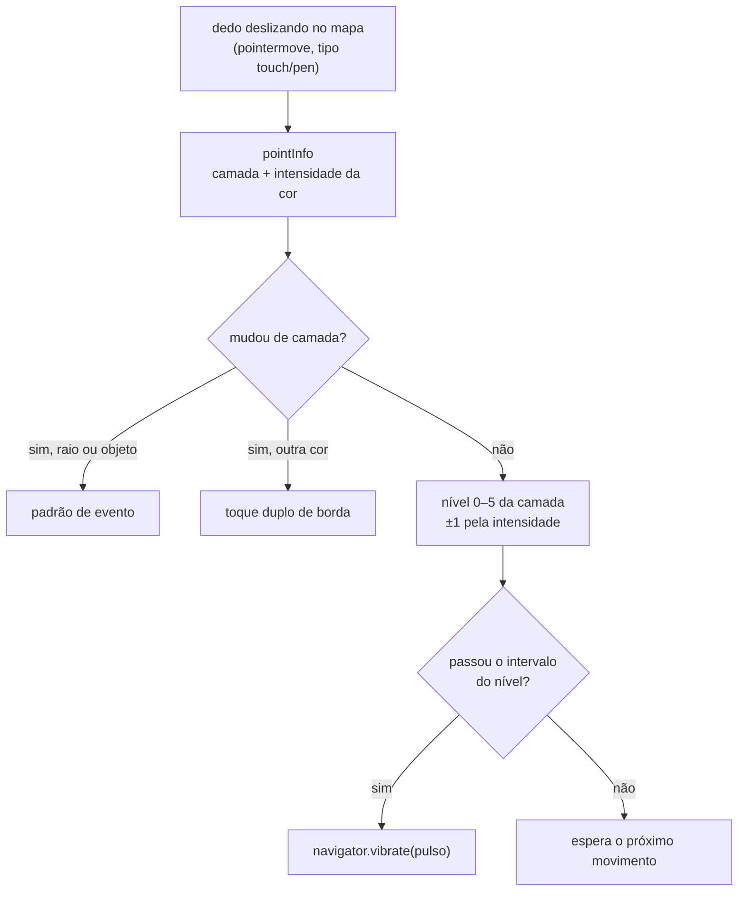

**Níveis** (intensidade “média”; na “suave”, os pulsos ficam 35% mais curtos; na “forte”, 45% mais longos e 15% mais próximos):

| Nível | Pulso | Intervalo | Exemplos |
|---|---|---|---|
| 0 · nenhuma | — | — | oceano, espaço, áreas sem dado |
| 1 · muito leve | 10 ms | 240 ms | continente sem fenômeno; branco nas fotos |
| 2 · leve | 16 ms | 170 ms | sal marinho, luz sem mudança; azul e verde nas fotos |
| 3 · média | 24 ms | 120 ms | poeira do Saara, luz que diminuiu; laranja e roxo nas fotos |
| 4 · forte | 34 ms | 85 ms | fumaça de queimadas, luzes novas; vermelho e objetos nas fotos |
| 5 · muito forte | 46 ms | 60 ms | raios; florestas mais altas |

**Padrões especiais:**

| Evento | Padrão (ms: vibra, pausa, vibra…) | Significado |
|---|---|---|
| Borda | `12, 40, 12` | o dedo passou para outra cor ou camada |
| Raio | `60, 40, 90` | encontrou um flash de raio |
| Objeto | `22, 40, 22, 40, 22` | entrou na caixa de um objeto reconhecido |

**Regras de projeto:**

- **Textura, não alarme.** O motor só pulsa enquanto o dedo se move; com o dedo parado, o aparelho fica quieto. É o mesmo princípio de passar a mão numa superfície.
- **Intensidade dentro da camada.** Cada camada tem um nível-base (`VIB_LV`). Pelos percentis 10 e 90 da intensidade de cor de cada camada, medidos nas imagens da NASA (`VIB_AMT`), o quarto mais intenso sobe 1 nível e o mais fraco desce 1. No GEDI, o nível acompanha a altura da floresta: 1 + 4 × altura relativa.
- **Fila sem sobreposição.** Um novo pulso só sai quando o anterior termina. Assim, padrões não se atropelam.
- **Opcional na reprodução.** Com “Vibrar também durante a reprodução”, cada passo da varredura pulsa no nível do fenômeno dominante, e raios e objetos disparam seus padrões.
- **Preferências salvas.** Ligado/desligado, intensidade e tipos de pulso ficam no `localStorage` (`eij.vib`).
- **iPhone (experimental).** O Safari não implementa a Vibration API. No iOS 18 ou mais novo, o app usa um recurso não documentado: clicar programaticamente num `<input type="checkbox" switch>` oculto produz o toque padrão do sistema. Não há níveis, e o recurso pode deixar de funcionar em versões futuras.

### 5.10 Interface e estado

- **Layout.** No computador, o mapa fica entre o menu e a coluna da direita, e `layoutMap` recalcula a posição a cada redimensionamento para que nada fique escondido. Abaixo de 1000 px de largura, tudo vira uma coluna rolável, e a barra superior se reorganiza em três linhas.
- **Painéis.** Agora no mapa, Cores e sons, Audiodescrição, Som, Vibração e Sobre abrem numa gaveta lateral; ao abrir um painel, o menu recolhe em ícones.
- **Idiomas.** Todos os textos, inclusive os falados e a documentação, vêm de `I18N` (PT e EN) e são trocados por `applyLang`.
- **Persistência.** No `localStorage` ficam a voz (`eij.voice`), a velocidade da voz (`eij.rate`) e a vibração (`eij.vib`). Os modelos da voz neural ficam no Cache API `ecos-da-terra`, com o IndexedDB `ecos-da-terra` como alternativa.
- **Documentação.** A seção **Como funciona**, no fim da página, explica o sistema para o público leigo, em PT e EN.

---

## 6. Decisões técnicas e justificativas

| Decisão | Alternativas consideradas | Por que escolhemos | Custo aceito |
|---|---|---|---|
| **Um único `index.html`, sem build** | React/Vite, app nativo, backend Node | abre com dois cliques, funciona offline, hospedagem gratuita, código auditável de ponta a ponta | arquivo grande (~1,5 MB) e código longo num só lugar |
| **JavaScript puro** | frameworks de UI | zero dependências obrigatórias; menos peso para aparelhos simples | mais código manual de interface |
| **Imagens em base64 dentro do HTML** | arquivos `.png/.jpg` ao lado | em `file://`, o navegador bloqueia a leitura de pixels (canvas “contaminado”); embutidas, sempre funcionam | +1,15 MB no arquivo (as originais também vão no pacote) |
| **Canvas 2D + `getImageData`** | WebGL, análise no servidor | nativo, simples, rápido o bastante para ler uma coluna por passo | leitura de imagens muito grandes exige redução (1600 px em fotos, 960 px em vídeos) |
| **Síntese em tempo real (Web Audio)** | arquivos de áudio prontos, Tone.js | latência baixa, som contínuo que acompanha o dedo, controle total de ADSR e estéreo, nenhum download | timbres sintéticos, menos “realistas” (ver [roteiro](#12-roteiro-próximas-funcionalidades)) |
| **Escalas pentatônicas** | frequência contínua (glissando) | várias camadas soando juntas sem dissonância; mais agradável para sessões longas | resolução de altura limitada aos graus da escala |
| **Regras por mapa feitas à mão** | modelo de IA genérico de “imagem → som” | coerência científica com a legenda de cada visualização da NASA; explicável em voz | cada novo mapa exige calibração |
| **Método NASA SVS #13786** | mapeamentos próprios | metodologia publicada pela NASA; dá consistência e credibilidade | — |
| **Web Speech + Piper** | ElevenLabs, Google Cloud TTS, Azure | gratuito, sem chave de API (nenhum segredo no navegador), sem enviar texto a servidores, funciona offline após o primeiro download | ~90 MB no primeiro uso; a voz neural pode demorar alguns segundos em aparelhos fracos |
| **Human (TensorFlow.js) + CenterNet** | YOLO via servidor, APIs de visão em nuvem | roda no aparelho (privacidade), gratuito, WebGL com alternativa em CPU | ~6 MB no primeiro uso; 80 classes; precisão menor que modelos grandes |
| **Vibration API com PWM** | aplicativo nativo, Gamepad API | padrão da web, sem instalar nada; funciona nos navegadores mais usados no Android | sem amplitude real; não funciona no iPhone nem no Firefox |
| **Geografia por polígonos simplificados** | base de mapas completa (GeoJSON detalhado) | leve (poucos KB), suficiente para nomear regiões e oceanos | imprecisão perto das costas |
| **Ajuste de geografia por terra/mar** | metadados da imagem | funciona com qualquer captura de tela ou exportação, sem depender de metadados | só aceita encaixes com alta confiança; senão, descreve por posição na imagem |

---

## 7. Acessibilidade

O projeto foi pensado primeiro para quem não vê a tela, e as escolhas seguem as diretrizes WCAG 2.2:

- **Alternativa ao conteúdo visual (1.1.1):** a audiodescrição e o texto (`aria-describedby`) do mapa descrevem cada imagem; a legenda sonora explica o código de cores.
- **Informação além da cor (1.4.1):** cada cor também tem nome, som e nível de vibração.
- **Teclado (2.1.1):** todos os comandos têm atalho; as setas exploram o mapa ponto a ponto.
- **Foco visível (2.4.7):** contorno âmbar de 3 px em todos os elementos focáveis.
- **Atalho para o conteúdo (2.4.1):** o link “Pular para o mapa sonoro” é o primeiro elemento da página.
- **Texto redimensionável (1.4.4):** três tamanhos (A, A+, A++), com a interface se reorganizando para caber.
- **Movimento reduzido (2.3.3):** com `prefers-reduced-motion`, as animações são desligadas.
- **Mensagens de status (4.1.3):** mudanças importantes são anunciadas por `aria-live` sem tirar o foco.
- **Nome, função e valor (4.1.2):** botões com `aria-label`, alternâncias com `role="switch"` e `aria-pressed`/`aria-checked`.
- **Idioma da página (3.1.1):** o `lang` muda entre `pt-BR` e `en` junto com a interface.
- **Áudio que não atrapalha (1.4.2):** volumes independentes para música e voz, com *ducking* automático e botão de parar.

---

## 8. Privacidade e segurança

- **Sem servidor:** fotos e vídeos são lidos e analisados só no aparelho; nada é enviado.
- **Sem chaves de API:** nenhum segredo fica no código ou no navegador. Os serviços pagos de voz foram descartados também por isso.
- **Sem rastreamento:** não há cookies, analytics nem coleta de dados. O `localStorage` guarda só preferências de uso.
- **Downloads opcionais e públicos:** bibliotecas e modelos vêm de CDNs públicas (jsDelivr, Hugging Face) e só quando o recurso é usado.
- **Controle pelo olhar (futuro):** foi projetado para rodar localmente, sem enviar a imagem da câmera.

---

## 9. Desempenho

| Item | Valor |
|---|---|
| Tamanho do `index.html` | ~1,48 MB (~1,15 MB de imagens + ~330 KB de código) |
| Leitura por passo | uma coluna de 3 px, em linhas alternadas |
| Telemetria na tela | no máximo a cada 120 ms |
| Vozes de áudio simultâneas | até 40 (as excedentes são descartadas) |
| Foto analisada | lado maior reduzido a 1600 px |
| Vídeo analisado | lado maior reduzido a 960 px; movimento a cada 100 ms; objetos a cada 1,2 s |
| Voz neural | 1 thread WASM; próxima frase sintetizada enquanto a atual toca; cache de 160 frases |
| Vibração | um pulso por vez, sem sobreposição, só com o dedo em movimento |

---

## 10. Compatibilidade

| Recurso | Chrome / Edge (PC) | Chrome / Edge / Samsung Internet (Android) | Firefox | Safari (Mac) | Safari (iPhone/iPad) |
|---|---|---|---|---|---|
| Mapas, som, legenda, teclado | ✅ | ✅ | ✅ | ✅ | ✅ |
| Voz do sistema | ✅ (Edge: vozes Natural) | ✅ | ✅ | ✅ | ✅ |
| Voz neural Piper | ✅ | ✅ (aparelhos recentes) | ✅ | ✅ | ⚠️ pode ser lenta |
| Foto e vídeo | ✅ | ✅ | ✅ | ✅ (MP4/MOV) | ✅ (MP4/MOV) |
| Objetos (WebGL) | ✅ | ✅ | ✅ | ✅ | ⚠️ pode cair para CPU |
| Vibração em níveis | — (sem motor) | ✅ | ❌ removida no Firefox 129 (2024) | — | ⚠️ só toque simples experimental (iOS 18+) |

---

## 11. Limitações do MVP

1. **Lemos a imagem, não os dados brutos.** As regras interpretam cores de visualizações prontas. Valores como concentração de aerossol ou variação exata de luz são aproximados a partir da cor e da área.
2. **Geografia simplificada.** Os contornos dos continentes têm poucas dezenas de vértices; pontos colados à costa podem receber o nome da região vizinha.
3. **Calibração manual.** Os quatro mapas foram calibrados um a um. Outras imagens do SVS só são reconhecidas automaticamente quando seguem o mesmo esquema de cores; nos outros casos, valem as regras gerais.
4. **Vibração limitada pela plataforma.** No Android, a força é simulada por PWM, e alguns aparelhos ignoram pulsos muito curtos ou seguem a configuração de vibração do sistema. A primeira vibração só acontece depois do primeiro toque na página (regra do navegador). Não funciona no Firefox, e no iPhone há apenas um toque experimental.
5. **Voz neural pesada.** ~90 MB no primeiro uso e alguns segundos de atraso por frase em aparelhos simples. A qualidade varia por voz e idioma.
6. **Objetos.** O modelo conhece 80 classes do COCO e pode errar em imagens escuras, desfocadas ou incomuns, gerando falsos positivos. Ele precisa de internet na primeira vez.
7. **Vídeo.** É analisado em resolução reduzida. Formatos dependem do navegador (MP4 H.264 e WebM são os mais seguros).
8. **Sem testes automatizados no repositório.** A verificação do MVP foi feita com roteiros de navegador automatizado (Playwright) fora do pacote; o [roteiro de teste manual](#roteiro-de-teste-manual) cobre o essencial.
9. **Controle pelo olhar não implementado.** O botão existe na interface para mostrar o recurso planejado.

---

## 12. Roteiro: próximas funcionalidades

### Em destaque: controle pelo olhar, com IA

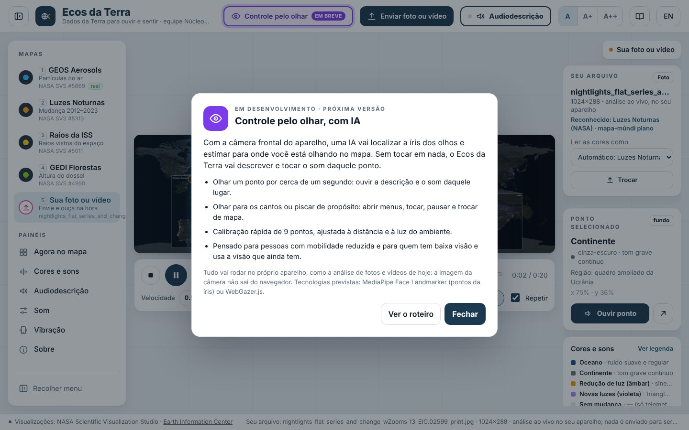

**Objetivo:** explorar o mapa sem as mãos. A câmera frontal localiza a íris e estima o ponto da tela para onde a pessoa olha.

**Como deve funcionar:**

| Ação | Gesto previsto |
|---|---|
| Ouvir a descrição e o som de um ponto | fixar o olhar por cerca de 1 s (*dwell time*) |
| Abrir menus, tocar, pausar, trocar de mapa | olhar para os cantos da tela ou piscar de propósito |
| Ajustar à pessoa | calibração de 9 pontos, ajustada à distância e à luz |

**Tecnologia prevista:**

- [MediaPipe Face Landmarker](https://ai.google.dev/edge/mediapipe/solutions/vision/face_landmarker), que marca 478 pontos do rosto, incluindo as íris, rodando em WASM/WebGL; ou
- [WebGazer.js](https://webgazer.cs.brown.edu/), com regressão calibrada pelo usuário.

O processamento será todo local. Haverá suavização do ponto de olhar (filtro de Kalman ou média móvel) e uma margem de tolerância. Assim, a interface reage ao alvo, e não a cada tremor do olho.

**Público:** pessoas com mobilidade reduzida e pessoas com baixa visão que usam a visão residual.

### Sons realistas, ligados ao que o mapa mostra

Hoje cada fenômeno é um timbre musical. A próxima versão terá um modo **realista**, em que o som lembra o fenômeno e o volume continua proporcional ao dado:

| Fenômeno | Som realista | Como gerar |
|---|---|---|
| Sal marinho | grãos de sal caindo ou sendo mexidos | síntese granular (ruído em grãos curtos, densidade = concentração) |
| Fumaça de queimadas | fogo crepitando | estalos aleatórios + ruído grave filtrado |
| Poeira do Saara | vento carregando areia | ruído rosa com filtro passa-banda modulado |
| Oceano | ondas quebrando | ruído com envelope lento (base já existe) |
| Raios | trovão distante | ruído grave com reverberação e atraso proporcional à distância |
| Florestas | vento nas copas e pássaros | ruído filtrado + chamados sintéticos, mais densos em dosséis altos |
| Luzes da cidade | burburinho urbano | camadas de ruído e tons graves |
| Luz que se apagou | cidade silenciando | o burburinho perde volume |

Os sons podem ser sintetizados (sem arquivos, coerente com o app de arquivo único) ou vir de bancos livres (CC0). Um seletor “musical × realista” deixará a escolha com a pessoa.

### Vibração em mais aparelhos

- **iPhone:** versão empacotada como aplicativo (por exemplo, Capacitor), com acesso ao Taptic Engine.
- **Controles de videogame:** `vibrationActuator` da Gamepad API, com força real de 0 a 1.
- **Relógios e pulseiras:** toques no pulso, com as mãos livres.
- **Luvas e canetas hápticas:** a textura do mapa sentida na ponta dos dedos.

### Outras ideias de acessibilidade, imersão e experiência multissensorial

| Ideia | O que muda para a pessoa | Caminho técnico |
|---|---|---|
| **Áudio 3D** | cada fenômeno soa da direção em que está no mapa, ao redor da cabeça | `PannerNode` com HRTF; rastreamento da cabeça pela câmera ou por fones com sensores |
| **Comandos de voz** | “o que tem sobre o Brasil?”, “vá para a Amazônia”, “mais rápido” | Web Speech API (reconhecimento) + gramática de comandos |
| **Assistente com IA** | perguntas livres sobre o mapa, respondidas com dados da imagem e fonte | LLM com os dados extraídos da imagem como contexto, rodando local ou em servidor opcional |
| **Libras** | avatar de Libras sincronizado com a audiodescrição, para pessoas surdas | [VLibras](https://www.gov.br/governodigital/pt-br/vlibras) (gratuito, governo federal) |
| **Mapas táteis e Braille** | exportar o mapa em relevo para impressora 3D ou papel microcapsulado, com legenda em Braille | geração de malha (STL) a partir da intensidade; fonte Braille |
| **Viagem no tempo** | ouvir a mudança ao longo dos anos | sequências temporais do SVS tocadas em ordem, com comparação antes/depois |
| **Dados ao vivo** | imagens do dia e eventos naturais em tempo real | NASA GIBS/Worldview (WMTS) e EONET |
| **Modo sala de aula** | a professora conduz e a turma ouve junto | sincronização por WebRTC ou WebSocket |
| **Perfis sensoriais** | modo calmo para pessoas autistas ou com TDAH, contraste reforçado, preferências salvas | menos vozes simultâneas, envelopes mais suaves, temas |
| **App instalável e offline** | instalar no celular e usar sem internet, inclusive voz e IA | PWA com *service worker* e pré-cache dos modelos |
| **Exportar áudio** | baixar a sonificação com audiodescrição em MP3 | `OfflineAudioContext` + codificador MP3 em WASM |
| **Controles adaptados** | navegar com um único botão (acionador) | Gamepad API, varredura automática de opções |

---

## 13. Estrutura do repositório e como contribuir

```
.
├── index.html                       # o app inteiro (HTML + CSS + JS + 4 imagens em base64)
├── README.md                        # este documento
├── Aerosols_2025-08-19T20_00_00_1920x1080.png              # originais da NASA SVS (referência)
├── nightlights_flat_series_and_change_wZooms_13_EIC.02599_print.jpg
├── iss_lightning_preview.jpg
├── GEDI_global_w_colorbar_0900_print.jpg
└── docs/
    └── img/                         # capturas de tela usadas neste README
```

As imagens originais ao lado do `index.html` são opcionais. O app usa primeiro as versões embutidas e, se elas faltarem, tenta os arquivos ao lado; se ambos falharem, desenha uma réplica procedural.

### Como adicionar um novo mapa da NASA

1. Inclua a imagem em `window.EIJ_IMAGES` (base64) e crie a entrada em `TRACKS` com `classify` (cor → fenômeno) e `sonify` (fenômeno → notas).
2. Descreva as cores e os sons em `LEG` e o fundo em `AMB_CFG`.
3. Calibre a geometria em `GEO` (equirretangular ou ortográfica) para nomear regiões.
4. Defina os níveis de vibração em `VIB_LV` (e, se quiser, a faixa de intensidade em `VIB_AMT`).
5. Escreva os textos em `I18N` (PT e EN): `title`, `desc`, `visual`, `rules`.

### Roteiro de teste manual

- [ ] Abrir o `index.html` por `file://` e pelo servidor local: os 4 mapas carregam como “real”.
- [ ] `L` toca a legenda; `Espaço` toca e pausa; as setas exploram; `Enter` descreve o ponto.
- [ ] `A` liga a audiodescrição; a voz descreve a imagem e as regras; a música abaixa enquanto ela fala.
- [ ] Enviar cada uma das 4 imagens originais pela faixa 5: o app reconhece o tipo e a geografia.
- [ ] Enviar uma foto comum: objetos reconhecidos (com internet), cores e contornos sonificados.
- [ ] Enviar um vídeo: movimento vira cliques, e o player controla o vídeo.
- [ ] No Android (Chrome): deslizar o dedo no mapa vibra; testar os níveis no painel **Vibração**.
- [ ] Trocar para EN: interface, voz e documentação mudam de idioma.
- [ ] A, A+ e A++ em 1280 px, 1440 px e no celular: nada fica cortado.

---

## 14. Créditos, fontes e licenças

### Dados e visualizações (NASA Goddard Space Flight Center, Scientific Visualization Studio)

- Galeria [Earth Information Center](https://svs.gsfc.nasa.gov/gallery/earth-information-center/)
- [#5669 · GEOS Aerosols](https://svs.gsfc.nasa.gov/5669/)
- [#5313 · Change in Night Lights 2012–2023 (EIC Version)](https://svs.gsfc.nasa.gov/5313/)
- [#5011 · Lightning Events Detected from the ISS (2017–2023)](https://svs.gsfc.nasa.gov/5011/)
- [#4950 · GEDI Forest Height](https://svs.gsfc.nasa.gov/4950/)
- Método de sonificação: [#13786 · Data Sonification: Caldwell 73](https://svs.gsfc.nasa.gov/13786/)

Os dados científicos pertencem à NASA, e o uso das imagens segue as diretrizes de mídia da NASA, mantendo os créditos ao SVS. O Ecos da Terra é um projeto independente, sem endosso da NASA.

### Bibliotecas de terceiros (carregadas sob demanda, não incluídas no arquivo)

| Biblioteca | Uso | Licença |
|---|---|---|
| [ONNX Runtime Web](https://github.com/microsoft/onnxruntime) 1.18.0 | executa o modelo de voz | MIT |
| [@diffusionstudio/piper-wasm](https://www.npmjs.com/package/@diffusionstudio/piper-wasm) 1.0.0 | fonemizador (eSpeak-ng em WASM) | MIT (o eSpeak-ng embutido é GPL-3.0) |
| [Piper voices](https://huggingface.co/rhasspy/piper-voices) (`pt_BR-faber-medium`, `en_US-lessac-medium`) | modelos de voz | ver o *model card* de cada voz |
| [Human](https://github.com/vladmandic/human) 3.3.6 (TensorFlow.js + CenterNet/COCO) | reconhecimento de objetos | MIT |

### Licença do código

Defina a licença antes de publicar. Sugestão: **MIT** para o código do Ecos da Terra, mantendo os créditos da NASA e as licenças das bibliotecas de terceiros.

---

<p align="center"><b>Ecos da Terra</b> · equipe Núcleo404 · NASA Space Apps Challenge 2026<br>Feito para ser ouvido, sentido e compreendido por todas as pessoas.</p>
